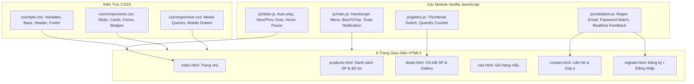

# Implementation Plan: Assignment GD1 - Website Bán Hàng Công Nghệ TechGear Store

Website thương mại điện tử chuyên cung cấp thiết bị và phụ kiện công nghệ (**TechGear Store**) phục vụ đồ án Assignment Giai đoạn 1 (GD1) môn **WEB1044 - Lập trình JavaScript cơ bản** (Lớp SD21303, FPT Polytechnic).



---

## User Review Required

- Toàn bộ mã nguồn sử dụng **HTML5, CSS3 và JavaScript thuần (ES6+)**, không dùng framework cồng kềnh, bám sát 100% barem chấm điểm môn WEB1044.
- Đầy đủ 6 trang giao diện chuẩn thương mại điện tử, có hình ảnh công nghệ và icon Font Awesome sắc nét.
- Các hàm JavaScript được chú thích tiếng Việt chi tiết cho từng dòng logic quan trọng.

---

## Proposed Changes

### 1. Kiến Trúc CSS & Thư Viện Giao Diện (`css/`)
- `css/style.css`: Khai báo biến màu, typography, CSS reset, layout header/nav/footer, utility classes.
- `css/components.css`: Slideshow banner, Product cards, Filter sidebar, Gallery view, Form controls, Cart tables.
- `css/responsive.css`: Breakpoints 1024px, 768px, 576px; mobile menu drawer, adaptive grids.

### 2. Các Module Logic JavaScript (`js/`)
- `js/slider.js`: Quản lý slideshow banner tự động, next/prev, dots indicator, pause on hover.
- `js/gallery.js`: Đổi ảnh lớn khi click thumbnails chi tiết sản phẩm, bộ đếm số lượng +/-.
- `js/validation.js`: Validate form Đăng ký (họ tên, email regex, sđt, mật khẩu khớp) & form Liên hệ.
- `js/main.js`: Hamburger menu toggle, Back to top button, Toast notifications.

### 3. Hệ Thống 6 Trang Giao Diện HTML5
- `index.html`: Trang chủ (Banner slider, danh mục, sản phẩm nổi bật, cam kết, footer).
- `products.html`: Danh sách sản phẩm kèm sidebar bộ lọc và phân trang.
- `detail.html`: Chi tiết sản phẩm với gallery đổi ảnh, thông số kỹ thuật, đánh giá.
- `cart.html`: Bảng giỏ hàng với các mặt hàng mẫu, tính tạm tính và mã giảm giá.
- `contact.html`: Thông tin showroom, bản đồ định vị và form liên hệ có validate.
- `register.html`: Form Đăng ký tài khoản và Đăng nhập với JavaScript validation.

---

## Verification Plan

### Automated Tests
```bash
node --check js/slider.js
node --check js/gallery.js
node --check js/validation.js
node --check js/main.js
```

### Manual Verification
1. Banner Slider trên `index.html`: Kiểm tra auto-slide, click next/prev/dots, hover pause.
2. Gallery trên `detail.html`: Click đổi thumbnail sang ảnh lớn, tăng giảm số lượng.
3. Validation trên `register.html` & `contact.html`: Kiểm tra bỏ trống, email sai định dạng, mật khẩu không khớp, realtime xóa lỗi.
4. Responsive: Menu hamburger co giãn mượt mà trên mobile, không vỡ layout ở mọi kích thước.
